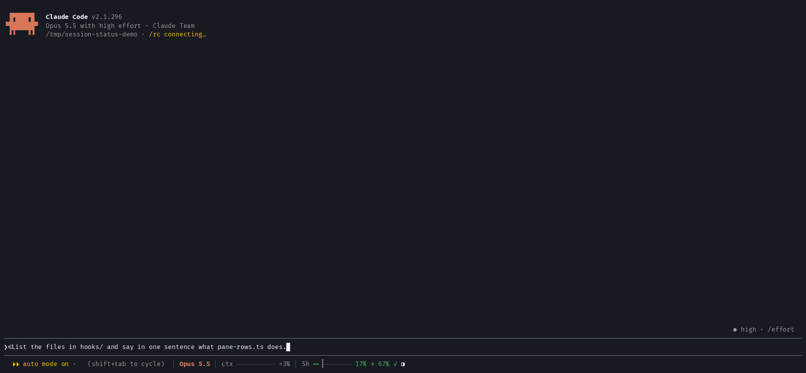
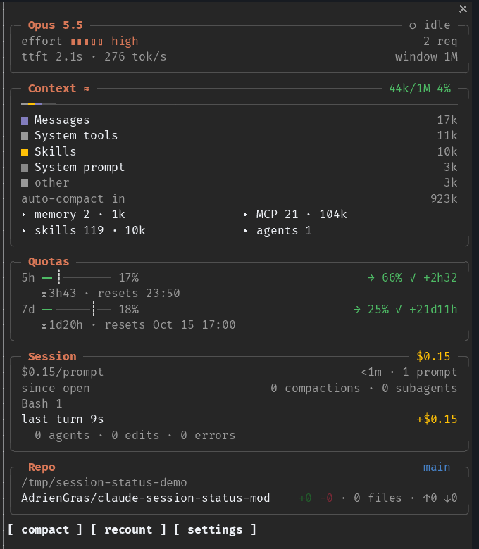

# 📟 session-status

[](https://github.com/AdrienGras/claude-session-status-mod/actions/workflows/ci.yml)
[](https://sonarcloud.io/summary/new_code?id=AdrienGras_claude-session-status-mod)
[](https://github.com/AdrienGras/claude-session-status-mod/tags)
[](LICENSE)
[](https://claude.com/blog/claude-code-mods)

**Your Claude Code status line, but native.** Model, effort, context by category, how fast you're burning through your quotas, session cost, your repo: all of it lives right under the prompt, with a side pane one keystroke away for the full picture. ✨

No script polling every ten seconds, no binary on the side: the mod reads the session itself and follows your Claude Code theme.

<p align="center"></p>

## ⚡ TL;DR

In a Claude Code terminal session:

```
/plugin install session-status --marketplace AdrienGras/claude-session-status-mod
```

Answer `y`, pick the **user** scope, done: the status line shows up under the prompt. 🎉
Then type `/sst` to open the side pane.

> [!TIP]
> Replacing an existing status line? Once you're happy, remove the `statusLine` entry from `~/.claude/settings.json`. The mod never touches your settings itself.

## 👀 What you get

### The status line

One line under the prompt, right where Claude Code draws its hint (which stays on the left):


- 🧠 **Model and effort**, the effort as five notches `▮▮▮▯▯`
- 📦 **Context**: a bar coloured by category (the same colours as `/context`) and how full the window is. Before the first reply, you get Claude Code's own estimate, marked `≈`.
- 🔥 **5h window**: what you've used, a `┊` mark where you *should* be at an even pace, and where you'll land at the reset. `✓` you've got time to spare, `⚠` you'll hit the wall before the reset at this pace.

Want more? The **7d window**, **session cost** and **branch & diff** are one `/sst config` away. Pick your items, reorder them, resize the bars. Whatever doesn't fit your terminal is dropped from the right, and `◨` opens the side pane.

### The side pane

`/sst` toggles it. In fullscreen at 110+ columns it docks beside the transcript; otherwise it opens above the prompt.



| Box | What's inside |
| --- | --- |
| 🧠 **Model** | model, effort, permission mode, working/idle, requests, time to first token and tokens per second of the last request, context window |
| 📦 **Context** | the bar and its four biggest categories (the rest as *other*), room left before auto-compaction, unfoldable lists of memory files, MCP servers and agents |
| 🔥 **Quotas** | every window your plan reports: 5h and 7d with used share, projection, verdict, time to reset and when it resets; a spend limit as a plain gauge |
| 💸 **Session** | cost, per hour and per prompt, duration, prompts, compactions, tool calls by tool, subagents, and a receipt of the last turn |
| 🌿 **Repo** | folder, `owner/repo`, branch, `+added −removed`, ahead/behind upstream, files you changed during this session |

At the bottom: **compact** runs `/compact` (after asking 🙏), **recount** counts the context exactly like `/context`, **settings** opens the settings.

## ⌨️ Commands

| Command | Does |
| --- | --- |
| `/sst` | open or close the side pane |
| `/sst config` | choose what the status line shows, in which order, and how wide the bars are (6–24) |
| `/sst debug` | print what the mod sees, for a bug report |

🐛 `/sst debug` prints figures and categories only: no path, MCP server, agent, skill, repo or branch name. Paste it in an issue without a second thought.

## 🔍 Measured, estimated, counted

We'd rather show nothing than a made-up number. Here's how each figure comes about:

- 🎨 **Colours** come from your Claude Code theme, so light, dark and colour-blind themes all read well. Gauges go from success to warning to error at 50% and 80% for context, and at 80% and 130% of projected use for quotas.
- ≈ **The context breakdown is an estimate**: Claude Code's local one, which costs nothing. **recount** swaps it for the exact count (one token-count request per tool and memory file, like `/context`), until the next turn brings the estimate back. The total and percentage are always the real ones.
- 📈 **Burn-rate projections** assume your pace so far holds until the reset. Early in a window (under 10% elapsed) they're marked `~` and drawn dim, because it's too soon to tell.
- ⏱️ **Time to first token and tokens per second** are timed by the mod around each request, so they include the network and other mods. They aren't the API's own figures.
- 🔢 **Compactions, tool calls and subagents** are counted by the mod since it loaded (*since open*). Cost, duration and prompts come from Claude Code and cover the whole session, a resumed one included.
- 🚫 A figure Claude Code doesn't have is left out, never shown as zero.

## 🔒 Privacy

The mod reads Claude Code's session data and runs `git` in your project for the repo box. On its own it makes **no network request and calls no model**. Only two buttons do, and only when you press them: **recount** (token-count requests, like `/context`) and **compact** (runs `/compact`). The only thing it keeps between sessions is your settings.

## 🛠️ Development

```sh
git clone https://github.com/AdrienGras/claude-session-status-mod
cd claude-session-status-mod
claude --plugin-dir .
claude plugin validate --strict . && claude plugin test .
```

The pure logic (formatting, burn rate, bars, context, git parsing, status line and pane rows) lives in `hooks/*.ts` and is unit-tested; the `*.tsx` files only draw. Every displayed string is in `hooks/strings.ts`. The demo above is recorded with `docs/media/record.sh`.

Mods are an early-access Claude Code feature: the API may change between releases. Found something off? [Open an issue](https://github.com/AdrienGras/claude-session-status-mod/issues/new/choose) with your `/sst debug` output, in English or French. 🙌 Want to send a fix? See [CONTRIBUTING.md](CONTRIBUTING.md). Changes are listed in [CHANGELOG.md](CHANGELOG.md).

## 📄 License

[MIT](LICENSE)
